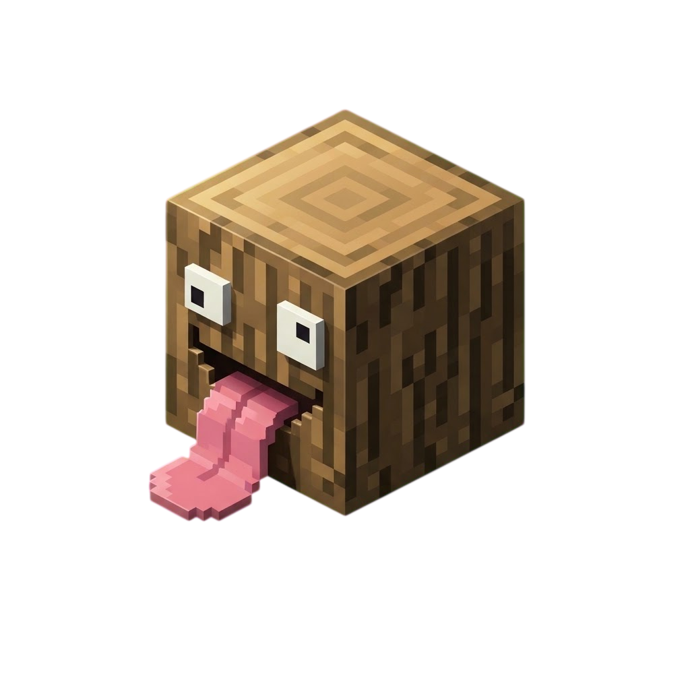

<p align="center">
  
</p>

<h1 align="center">locale-bridge</h1>

<p align="center">
  A PocketMine-MP 5 virion for custom server translations and locale-aware player messages.
</p>

<p align="center">
  
  
  
</p>

`locale-bridge` loads PocketMine-style `.ini` files, merges them with PocketMine's built-in translations, updates the server language, and resolves a `Language` instance from a Bedrock locale such as `en_US` or `fr_FR`.

## Features

- Custom translations stored in regular PocketMine `.ini` files.
- Built-in PocketMine translations for keys that are not overridden.
- Bedrock locale to PocketMine language-code mapping.
- Server-wide and per-player translation helpers.
- `LanguageCreationEvent` for selecting a custom `Language` subclass.
- A CLI generator for typed translation keys, parameter metadata, and factories.

## Requirements

- PocketMine-MP 5.x (`api: 5.0.0`).
- PHP 8.4 (other PHP versions are not supported).
- Composer and the Phar extension when building the virion from source.

Development is validated against the `axolotl-pm/pocketmine-mp` fork locked by this repository. Re-test the virion when targeting another PocketMine distribution or updating the server.

## Installation

`locale-bridge` is a virion, not a standalone plugin. Its PHAR must be injected into a plugin with a virion-compatible build workflow; do not place it directly in the server's `plugins` directory.

Build the virion from the project root:

```bash
composer make
```

The command installs the development dependencies and creates `locale-bridge.phar` in the project root. This repository does not provide an injector, so use the injection workflow of the consuming plugin.

## Language files

Create one `.ini` file per PocketMine language code. The filename is the language code, and `language.name` is required for PocketMine to discover the file.

```text
resources/languages/
├── eng.ini
└── fra.ini
```

```ini
; resources/languages/eng.ini
language.name=English
example.welcome=Welcome, {%0}!
```

```ini
; resources/languages/fra.ini
language.name=Français
example.welcome=Bienvenue, {%0} !
```

Translation parameters use PocketMine's `{%0}`, `{%1}`, ... placeholders.

The directory passed to `LocaleBridge::load()` must be readable and contain at least one valid language file. When possible, provide a file matching the language configured by the server. Otherwise, the first discovered custom language becomes the fallback.

## Quick start

`LocaleBridge` exposes a static API and must not be instantiated. Copy the bundled language files before calling `load()`:

```php
<?php

declare(strict_types=1);

namespace example;

use pocketmine\plugin\PluginBase;
use Symfony\Component\Filesystem\Path;
use zwuiix\locale\LocaleBridge;

final class Main extends PluginBase
{
	protected function onEnable() : void
	{
		$this->saveResource("languages/eng.ini");
		$this->saveResource("languages/fra.ini");

		LocaleBridge::load(
			$this,
			Path::join($this->getDataFolder(), "languages")
		);
	}
}
```

Call `load()` once, during startup, and only after the language files are available. It loads the custom definitions and replaces PocketMine's internal server `Language` instance.

> [!CAUTION]
> `load()` changes private PocketMine state through reflection. Re-test this integration after every PocketMine update.

## Translating for a player

Call `fromLocale()` after the languages have been loaded successfully. It accepts a Bedrock locale, a PocketMine language code, or `null` to use the server language.

```php
use zwuiix\locale\LocaleBridge;

$language = LocaleBridge::fromLocale($player->getLocale());
$message = $language->translateString(
	"example.welcome",
	[$player->getName()]
);

$player->sendMessage($message);
```

If the project already owns a custom Player class, it can expose locale-aware translations directly:

```php
use pocketmine\lang\Language;
use zwuiix\locale\LocaleBridge;

public function getLanguage() : Language
{
	return LocaleBridge::fromLocale($this->getLocale());
}
```

This direct integration is also available when the project already owns its Player class.

### Player adapter

`LocaleBridge::register()` installs a `PlayerCreationEvent` handler that extends the Player class selected by previous listeners and overrides its `getLanguage()` method.

Register the adapter once, before the first player is created:

```php
protected function onEnable() : void
{
	LocaleBridge::register($this);
	LocaleBridge::load(
		$this,
		$this->getDataFolder() . "languages"
	);
}
```

> [!WARNING]
> Custom Player classes are a PocketMine power-user feature and may conflict with other plugins using `PlayerCreationEvent`.

## Locale mapping

Unknown locales fall back to the server language. The following Bedrock locales are mapped explicitly:

| Bedrock locale | PocketMine code |
| --- | --- |
| `zh_CN`, `zh_TW` | `chs` |
| `de_DE` | `deu` |
| `en_GB`, `en_US` | `eng` |
| `fr_CA`, `fr_FR` | `fra` |
| `it_IT` | `ita` |
| `ja_JP` | `jpn` |
| `ko_KR` | `kor` |
| `nl_NL` | `nld` |
| `ru_RU` | `rus` |
| `es_ES`, `es_MX` | `spa` |
| `tr_TR` | `tur` |

Passing an already loaded PocketMine code such as `eng` or `fra` returns that language directly.

## API reference

| Method | Purpose |
| --- | --- |
| `LocaleBridge::load(Plugin $plugin, string $path)` | Loads and merges the language files, then updates the server language. |
| `LocaleBridge::fromLocale(?string $lang = null)` | Resolves a loaded `Language` from a locale or PocketMine code. |
| `LocaleBridge::register(Plugin $plugin)` | Registers the locale-aware custom-Player adapter. |
| `LocaleBridge::isRegistered()` | Reports whether the Player adapter was registered; it does not report whether languages were loaded. |

## Custom Language class

`LanguageCreationEvent` follows PocketMine's class-selection pattern. Register the listener before calling `LocaleBridge::load()`:

```php
use pocketmine\event\Listener;
use pocketmine\lang\Language;
use zwuiix\locale\event\LanguageCreationEvent;

final class CustomLanguage extends Language
{
	// Override translation behaviour here.
}

final class LanguageListener implements Listener
{
	public function onLanguageCreation(LanguageCreationEvent $event) : void
	{
		$event->setLanguageClass(CustomLanguage::class);
	}
}
```

Register the listener and then load the language files:

```php
$this->getServer()->getPluginManager()->registerEvents(
	new LanguageListener(),
	$this
);

LocaleBridge::load(
	$this,
	$this->getDataFolder() . "languages"
);
```

The class passed to `setLanguageClass()` must be concrete, extend `pocketmine\lang\Language`, and accept the language code through its constructor. The event exposes:

- `getLanguageCode()` to read the PocketMine language code being created.
- `getLanguageClass()` and `setLanguageClass()` to inspect or replace the selected class.
- `getBaseClass()` and `setBaseClass()` for listener coordination.

> [!NOTE]
> In version 1.0.1, a language already loaded from the custom directory keeps its original `Language` object. For that code, `fromLocale()` is not guaranteed to return the subclass selected by `LanguageCreationEvent`.

## Typed translation API generator

The generator reads any PocketMine-style INI file and writes three namespaced PHP classes:

- `KnownTranslationKeys.php`
- `KnownTranslationParameterInfo.php`
- `KnownTranslationFactory.php`

Reproducible example using the locked PocketMine dependency:

```bash
php scripts/known-translation-apis.php \
  --input=vendor/axolotl-pm/pocketmine-mp/resources/translations/eng.ini \
  --namespace='Example\Plugin\Lang' \
  --output=generated/lang
```

All three options are required. Long options accept both `--option=value` and `--option value`; the short aliases are `-i`, `-n`, and `-o`. Relative paths are resolved from the current working directory.

```bash
php scripts/known-translation-apis.php --help
```

The output directory is created when necessary. Existing generated files with the same names are replaced, so generated code should not be edited manually. Ensure that the selected output directory is included by the consuming project's autoloader or build process.

## Development

Install dependencies:

```bash
composer install
```

Build the virion:

```bash
composer make
```

Apply the configured coding style to `src/` and `build/`:

```bash
composer cs-fixer
```

Run basic syntax checks:

```bash
php -l src/LocaleBridge.php
php -l src/event/LanguageCreationEvent.php
php -l scripts/known-translation-apis.php
```

## License

`locale-bridge` is licensed under the [Apache License 2.0](LICENSE).
